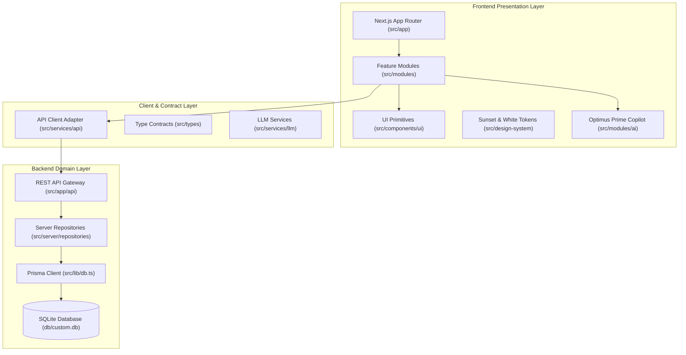

# FleetVision AI — Architecture & Domain Structure

## 1. High-Level Architectural Overview

FleetVision AI follows an **Enterprise Modular Architecture** designed for high-performance automotive telematics, real-time fleet operations, and predictive intelligence.



---

## 2. Directory Structure Breakdown

```
Fleet Vision Web/
├── 📂 prisma/                     # Database Schema & Migrations
│   └── schema.prisma              # 18 Prisma Models (Vehicle, Driver, Trip, Health, etc.)
│
├── 📂 db/                         # Persistent Database Storage
│   └── custom.db                  # SQLite production database
│
├── 📂 src/
│   ├── 📂 server/                 # [BACKEND DOMAIN LAYER]
│   │   ├── 📂 repositories/       # Encapsulated data-access repositories
│   │   │   ├── vehicleRepository.ts
│   │   │   ├── driverRepository.ts
│   │   │   └── tripRepository.ts
│   │   └── index.ts               # Server layer exports
│   │
│   ├── 📂 app/                    # [ROUTING & API GATEWAY]
│   │   ├── 📂 api/                # Backend REST API Handlers
│   │   │   ├── 📂 auth/           # Session & Login endpoints
│   │   │   ├── 📂 vehicles/       # Vehicle CRUD & unit telemetry
│   │   │   ├── 📂 drivers/        # Driver profiles & safety ratings
│   │   │   ├── 📂 trips/          # Mission dispatch & corridor logs
│   │   │   ├── 📂 fuel/           # Fuel refill & energy sessions
│   │   │   ├── 📂 maintenance/    # Service orders & repair schedules
│   │   │   ├── 📂 expenses/       # Financial ledger & operating P&L
│   │   │   ├── 📂 notifications/  # System alerts & telemetry updates
│   │   │   ├── 📂 dashboard/      # Executive KPI rollups
│   │   │   └── 📂 ai/             # Predictive ML models
│   │   │
│   │   ├── 📂 (app)/              # Authenticated Application Views
│   │   │   ├── 📂 dashboard/      # Executive KPI Dashboard
│   │   │   ├── 📂 vehicles/       # Vehicle Management & 12-Module Console
│   │   │   ├── 📂 drivers/        # Driver Management & Safety Radar
│   │   │   ├── 📂 trips/          # Mission Dispatches & Routes
│   │   │   ├── 📂 tracking/       # Live Fleet Telemetry Map
│   │   │   ├── 📂 fuel/           # Energy & Fuel Management
│   │   │   ├── 📂 maintenance/    # Maintenance & Service History
│   │   │   ├── 📂 expenses/       # Expense Tracking & Financials
│   │   │   ├── 📂 ai-center/      # Predictive AI Intelligence Models
│   │   │   ├── 📂 ai-assistant/   # Optimus AI Dedicated Console
│   │   │   ├── 📂 reports/        # Fleet Analytics & Reports
│   │   │   └── layout.tsx         # Authenticated Root Shell (Ambient Sunset Background)
│   │   │
│   │   ├── 📂 login/              # Cinematic Dark Volvo FH16 Login Experience
│   │   └── page.tsx               # Public Editorial Landing Page
│   │
│   ├── 📂 modules/                # [FRONTEND DOMAIN MODULES]
│   │   ├── 📂 ai/                 # Optimus Prime Floating Copilot Widget
│   │   ├── 📂 layout/             # Sidebar, Header, Navigation Config
│   │   ├── 📂 vehicles/           # 360° Explorer & Hotspot Inspection
│   │   ├── 📂 authentication/     # Cockpit Login & Transformation Scenes
│   │   ├── 📂 3d/                 # Three.js / WebGL Automotive Contracts
│   │   └── 📂 public-site/        # Editorial Landing Components
│   │
│   ├── 📂 services/               # [INTEGRATION & CLIENT SERVICES]
│   │   ├── 📂 api/                # Typed API Adapters (LiveClient & DemoClient)
│   │   └── 📂 llm/                # LLM Provider Interfaces & Tool Definitions
│   │
│   ├── 📂 components/ui/          # [REUSABLE UI PRIMITIVES] (Atomic Design)
│   ├── 📂 design-system/          # [THEME & DESIGN SYSTEM] (Sunset & White tokens)
│   ├── 📂 hooks/                  # [REUSABLE CLIENT HOOKS]
│   ├── 📂 lib/                    # [UTILITIES & DB CLIENT] (Prisma db.ts)
│   └── 📂 types/                  # [TYPE CONTRACTS] (fleet.ts)
│
├── 📂 public/                     # Static Automotive Media Assets
│   └── 📂 assets/vehicles/        # Volvo FH16 & FH Aero Electric visual assets
└── 📂 download/                   # Project Presentation & Zeroth Review Slides
```

---

## 3. Layer Separation of Concerns

### A. Backend Domain Layer
- **Database**: SQLite via Prisma ORM (`prisma/schema.prisma`).
- **Repositories (`src/server/repositories/`)**: Abstract database operations away from route handlers to ensure clean, reusable data queries with strict TypeScript validation.
- **REST Endpoints (`src/app/api/`)**: Handle HTTP requests, query params, pagination, authentication validation, and response serialization.

### B. Frontend Presentation Layer
- **App Router (`src/app/(app)/`)**: Server and client page viewports wrapped with authenticated layout guards and dynamic sunset ambient styling.
- **Feature Modules (`src/modules/`)**: Self-contained business UI units (e.g. `MultiAngleVehicleViewer`, `OptimusAssistantWidget`, `AppSidebar`).
- **Design System (`src/design-system/`)**: Centralized color tokens (`#FFFFFF`, `#FFF1E6`, `#FFE3B3`, `#07518A`, `#0C1E36`, `#EA6113`), with Electric Yellow (`#F5E500`) strictly reserved for EV charging metrics.

### C. Client Integration & Adapter Pattern (`src/services/api/`)
- Uses the **Adapter Pattern** with `IFleetVisionApiClient`.
- Automatically routes calls to `FleetVisionLiveClient` (calling real backend REST APIs) with seamless fallback to `FleetVisionDemoClient` when simulated demo telemetry is required.

---

## 4. AI & LLM Copilot Integration
- **Optimus Assistant Widget (`src/modules/ai/OptimusAssistantWidget.tsx`)**:
  - Persistent, floating assistant anchored in the bottom-right corner across all authenticated pages.
  - Custom geometric **Optimus Prime / Transformer** SVG crest icon.
  - Real-time queries for vehicle health, predictive maintenance, fuel consumption, and driver behavior linked to `/api/ai/*`.
- **LLM Services Layer (`src/services/llm/`)**:
  - `ILlmProvider` interface ready for plug-and-play LLM connection (Gemini, OpenAI, Claude, or local Ollama runtime).
  - Pre-engineered tool definitions in `tools.ts` for function calling against fleet database entities.
